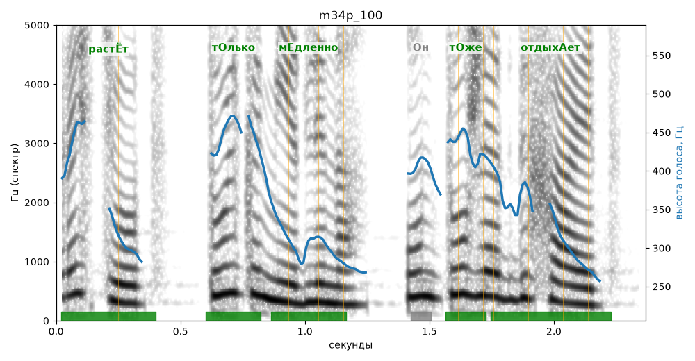

# m34p_100

Голос: **Пик (голос iPhone Milena), серия 34** · длительность 2.4 с
Эталон: Растёт. Только медленно. Он тоже отдыхает.
Распознано: Растёт, Тулька не дина, он тоже отбегает.
Расхождения в словах: «только медленно» → «тулька не дина»; «отдыхает» → «отбегает»

## Ударения
(где нужно: ruaccent)

| слово | нужно | у голоса | |
|---|---|---|---|
| растёт | растЁт | растЁт | ✓ |
| только | тОлько | тОлько | ✓ |
| медленно | мЕдленно | мЕдленно | ✓ |
| тоже | тОже | тОже | ✓ |
| отдыхает | отдыхАет | отдыхАет | ✓ |

## Интонация
- ✗ «только медленно.» — конец фразы не понижается — звучит незаконченно / как перечисление
- ✓ «он тоже отдыхает.» — конец фразы понижается — звучит законченно
- Диапазон голоса 9.2 полутонов (живо), средняя высота 353 Гц

## Паузы и темп
- паузы на своих местах
- Темп 8.0 слога/с (быстро)

_Синяя линия — высота голоса. Над словами заглавная буква — где ударение должно быть; красным — голос поставил не туда (уверенно), оранжевым — возможно._
