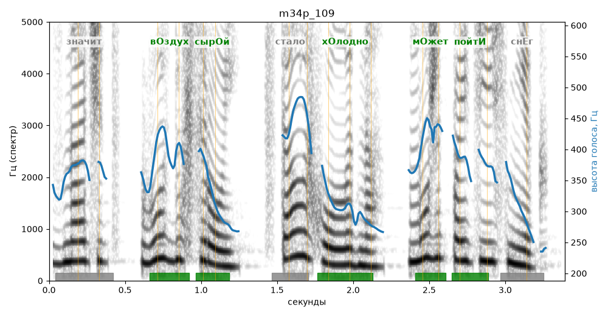

# m34p_109

Голос: **Пик (голос iPhone Milena), серия 34** · длительность 3.4 с
Эталон: Значит, воздух сырой. Стало холодно. Может пойти снег.
Распознано: Значит, воздусрой, стало холодно, может пойти снег.
Расхождения в словах: «воздух сырой» → «воздусрой»

## Ударения
(где нужно: ruaccent)

| слово | нужно | у голоса | |
|---|---|---|---|
| значит | значит | знАчит | нет эталона |
| воздух | вОздух | вОздух | ✓ |
| сырой | сырОй | сырОй | ✓ |
| стало | стало | стАло | нет эталона |
| холодно | хОлодно | хОлодно | ✓ |
| может | мОжет | мОжет | ✓ |
| пойти | пойтИ | пойтИ | ✓ |

## Интонация
- ✓ «значит воздух сырой.» — конец фразы понижается — звучит законченно
- ✗ «стало холодно.» — конец фразы не понижается — звучит незаконченно / как перечисление
- ✓ «может пойти снег.» — конец фразы понижается — звучит законченно
- Диапазон голоса 8.9 полутонов (живо), средняя высота 363 Гц

## Паузы и темп
- паузы на своих местах
- Темп 6.6 слога/с (быстро)

_Синяя линия — высота голоса. Над словами заглавная буква — где ударение должно быть; красным — голос поставил не туда (уверенно), оранжевым — возможно._
