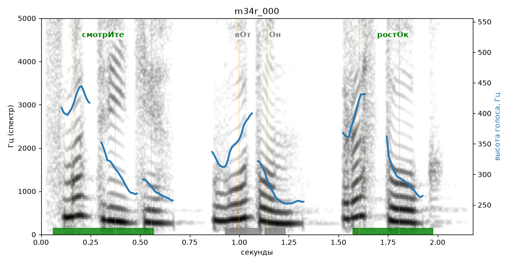

# m34r_000

Голос: **Рон (голос iPhone Milena), серия 34** · длительность 2.2 с
Эталон: Смотрите! Вот он! Росток!
Распознано: Смотрите, вот он, просток.
Расхождения в словах: «росток» → «просток»

## Ударения
(где нужно: ruaccent)

| слово | нужно | у голоса | |
|---|---|---|---|
| смотрите | смотрИте | смотрИте | ✓ |
| росток | ростОк | ростОк | ✓ |

## Интонация
- ✗ «смотрите!» — восклицание звучит ровно, без эмоции
- Диапазон голоса 9.1 полутонов (живо), средняя высота 308 Гц

## Паузы и темп
- паузы на своих местах
- Темп 5.8 слога/с (нормально)

_Синяя линия — высота голоса. Над словами заглавная буква — где ударение должно быть; красным — голос поставил не туда (уверенно), оранжевым — возможно._
