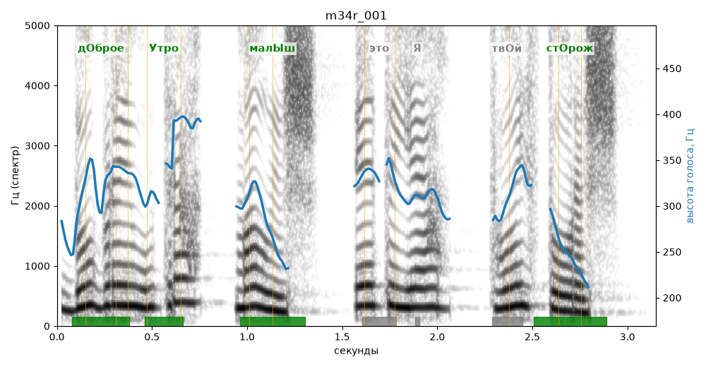

# m34r_001

Голос: **Рон (голос iPhone Milena), серия 34** · длительность 3.1 с
Эталон: Доброе утро, малыш. Это я, твой сторож.
Распознано: Доброе утро, малыш, это я, твой сторож.
Слова: все совпали

## Ударения
(где нужно: ruaccent)

| слово | нужно | у голоса | |
|---|---|---|---|
| доброе | дОброе | дОброе | ✓ |
| утро | Утро | Утро | ✓ |
| малыш | малЫш | малЫш | ✓ |
| это | это | Это | нет эталона |
| сторож | стОрож | стОрож | ✓ |

## Интонация
- ✓ «доброе утро малыш.» — конец фразы понижается — звучит законченно
- ✓ «это я твой сторож.» — конец фразы понижается — звучит законченно
- Диапазон голоса 8.9 полутонов (живо), средняя высота 312 Гц

## Паузы и темп
- паузы на своих местах
- Темп 6.6 слога/с (быстро)

_Синяя линия — высота голоса. Над словами заглавная буква — где ударение должно быть; красным — голос поставил не туда (уверенно), оранжевым — возможно._
