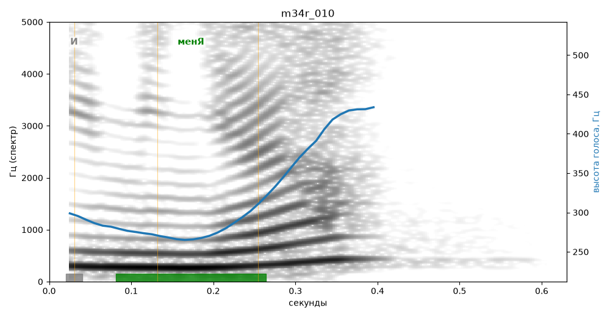

# m34r_010

Голос: **Рон (голос iPhone Milena), серия 34** · длительность 0.6 с
Эталон: И меня?
Распознано: Име.
Расхождения в словах: «и меня» → «име»

## Ударения
(где нужно: ruaccent)

| слово | нужно | у голоса | |
|---|---|---|---|
| меня | менЯ | менЯ | ✓ |

## Интонация
- ✗ «и меня?» — нет вопросительного подъёма (самое высокое место — «меня», в начале) — звучит как утверждение
- Диапазон голоса 8.4 полутонов (живо), средняя высота 292 Гц

## Паузы и темп
- паузы на своих местах
- Темп 12.3 слога/с (быстро)

_Синяя линия — высота голоса. Над словами заглавная буква — где ударение должно быть; красным — голос поставил не туда (уверенно), оранжевым — возможно._
