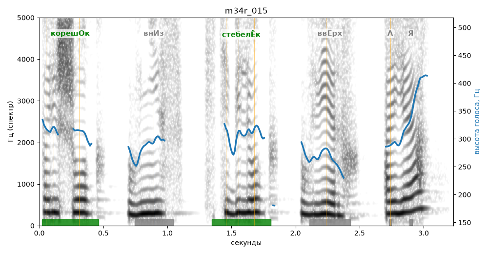

# m34r_015

Голос: **Рон (голос iPhone Milena), серия 34** · длительность 3.2 с
Эталон: Корешок — вниз, стебелёк — вверх. А я?
Распознано: Хорошо, вниз, стебелек, вверх, а я.
Расхождения в словах: «корешок» → «хорошо»

## Ударения
(где нужно: ruaccent)

| слово | нужно | у голоса | |
|---|---|---|---|
| корешок | корешОк | корешОк | ✓ |
| стебелёк | стебелЁк | стебелЁк | ✓ |

## Интонация
- ✓ «корешок вниз стебелёк вверх.» — конец фразы понижается — звучит законченно
- Диапазон голоса 7.5 полутонов (живо), средняя высота 297 Гц

## Паузы и темп
- паузы на своих местах
- Темп 5.3 слога/с (нормально)

_Синяя линия — высота голоса. Над словами заглавная буква — где ударение должно быть; красным — голос поставил не туда (уверенно), оранжевым — возможно._
