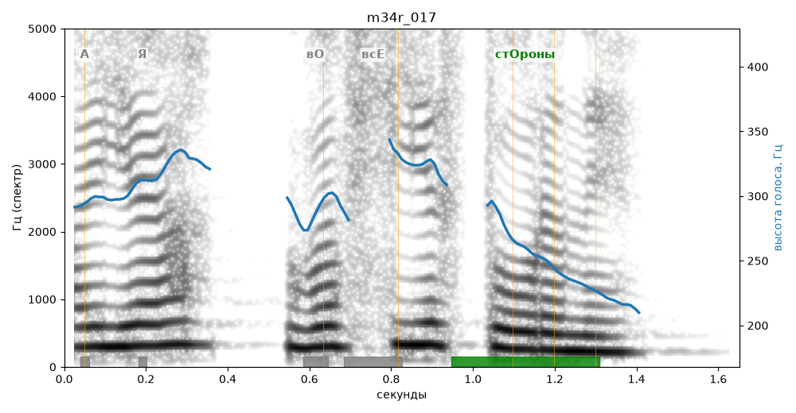

# m34r_017

Голос: **Рон (голос iPhone Milena), серия 34** · длительность 1.7 с
Эталон: А я — во все стороны!
Распознано: А я, во все стороны.
Слова: все совпали

## Ударения
(где нужно: ruaccent)

| слово | нужно | у голоса | |
|---|---|---|---|
| стороны | стОроны | стОроны | ✓ |

## Интонация
- ✓ «а я во все стороны!» — выделено слово «все» (+2.7 пт)
- Диапазон голоса 7.3 полутонов (живо), средняя высота 295 Гц

## Паузы и темп
- паузы на своих местах
- Темп 6.8 слога/с (быстро)

_Синяя линия — высота голоса. Над словами заглавная буква — где ударение должно быть; красным — голос поставил не туда (уверенно), оранжевым — возможно._
