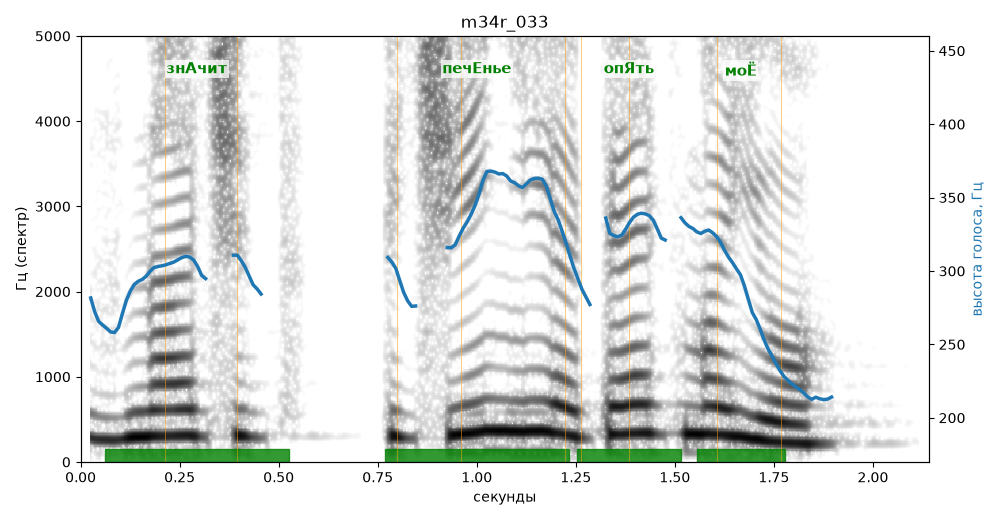

# m34r_033

Голос: **Рон (голос iPhone Milena), серия 34** · длительность 2.1 с
Эталон: Значит, печенье опять моё.
Распознано: Значит, печенье опять мое.
Слова: все совпали

## Ударения
(где нужно: ruaccent)

| слово | нужно | у голоса | |
|---|---|---|---|
| значит | знАчит | знАчит | ✓ |
| печенье | печЕнье | печЕнье | ✓ |
| опять | опЯть | опЯть | ✓ |
| моё | моЁ | моЁ | ✓ |

## Интонация
- ✓ «значит печенье опять моё.» — конец фразы понижается — звучит законченно
- Диапазон голоса 9.0 полутонов (живо), средняя высота 307 Гц

## Паузы и темп
- паузы на своих местах
- Темп 6.1 слога/с (нормально)

_Синяя линия — высота голоса. Над словами заглавная буква — где ударение должно быть; красным — голос поставил не туда (уверенно), оранжевым — возможно._
