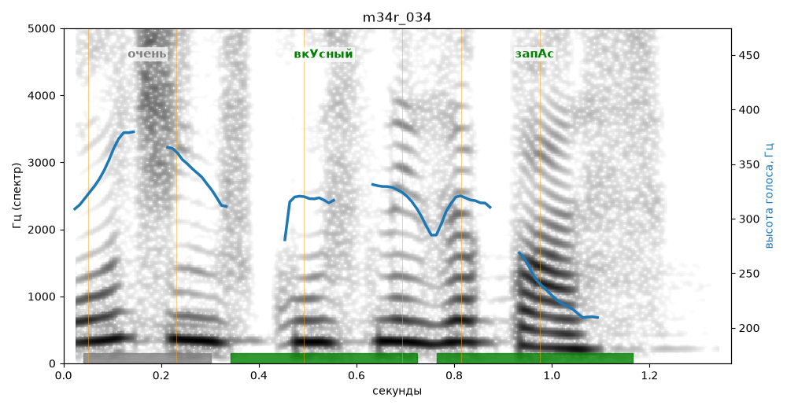

# m34r_034

Голос: **Рон (голос iPhone Milena), серия 34** · длительность 1.4 с
Эталон: Очень вкусный запас.
Распознано: Очень вкусный запас.
Слова: все совпали

## Ударения
(где нужно: ruaccent)

| слово | нужно | у голоса | |
|---|---|---|---|
| очень | очень | Очень | нет эталона |
| вкусный | вкУсный | вкУсный | ✓ |
| запас | запАс | запАс | ✓ |

## Интонация
- ✓ «очень вкусный запас.» — конец фразы понижается — звучит законченно
- Диапазон голоса 9.4 полутонов (живо), средняя высота 317 Гц

## Паузы и темп
- паузы на своих местах
- Темп 5.3 слога/с (нормально)

_Синяя линия — высота голоса. Над словами заглавная буква — где ударение должно быть; красным — голос поставил не туда (уверенно), оранжевым — возможно._
