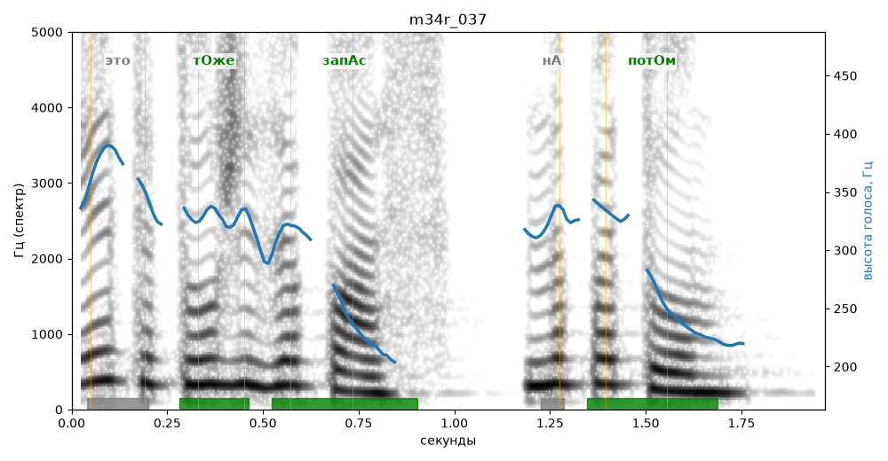

# m34r_037

Голос: **Рон (голос iPhone Milena), серия 34** · длительность 2.0 с
Эталон: Это тоже запас. На потом.
Распознано: Это тоже запас, на потом.
Слова: все совпали

## Ударения
(где нужно: ruaccent)

| слово | нужно | у голоса | |
|---|---|---|---|
| это | это | Это | нет эталона |
| тоже | тОже | тОже | ✓ |
| запас | запАс | запАс | ✓ |
| потом | потОм | потОм | ✓ |

## Интонация
- ✓ «это тоже запас.» — конец фразы понижается — звучит законченно
- ✓ «на потом.» — конец фразы понижается — звучит законченно
- Диапазон голоса 9.4 полутонов (живо), средняя высота 320 Гц

## Паузы и темп
- паузы на своих местах
- Темп 6.8 слога/с (быстро)

_Синяя линия — высота голоса. Над словами заглавная буква — где ударение должно быть; красным — голос поставил не туда (уверенно), оранжевым — возможно._
