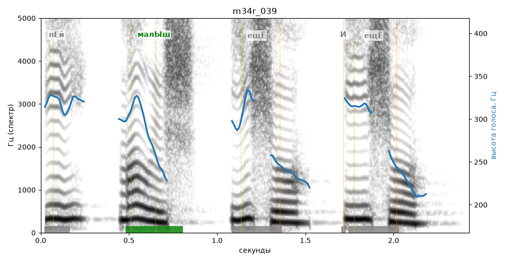

# m34r_039

Голос: **Рон (голос iPhone Milena), серия 34** · длительность 2.4 с
Эталон: Пей, малыш! Ещё! И ещё!
Распознано: Вмозь, ищу, ищу.
Расхождения в словах: «пей малыш еще и еще» → «вмозь ищу ищу»

## Ударения
(где нужно: ruaccent)

| слово | нужно | у голоса | |
|---|---|---|---|
| малыш | малЫш | малЫш | ✓ |
| ещё | ещЁ | Ещё | ? не разобрать |
| ещё | ещЁ | Ещё | ? не разобрать |

## Интонация
- ✗ «пей малыш!» — восклицание звучит ровно, без эмоции
- ✗ «и ещё!» — восклицание звучит ровно, без эмоции
- Диапазон голоса 7.4 полутонов (живо), средняя высота 297 Гц

## Паузы и темп
- паузы на своих местах
- Темп 7.5 слога/с (быстро)

_Синяя линия — высота голоса. Над словами заглавная буква — где ударение должно быть; красным — голос поставил не туда (уверенно), оранжевым — возможно._
