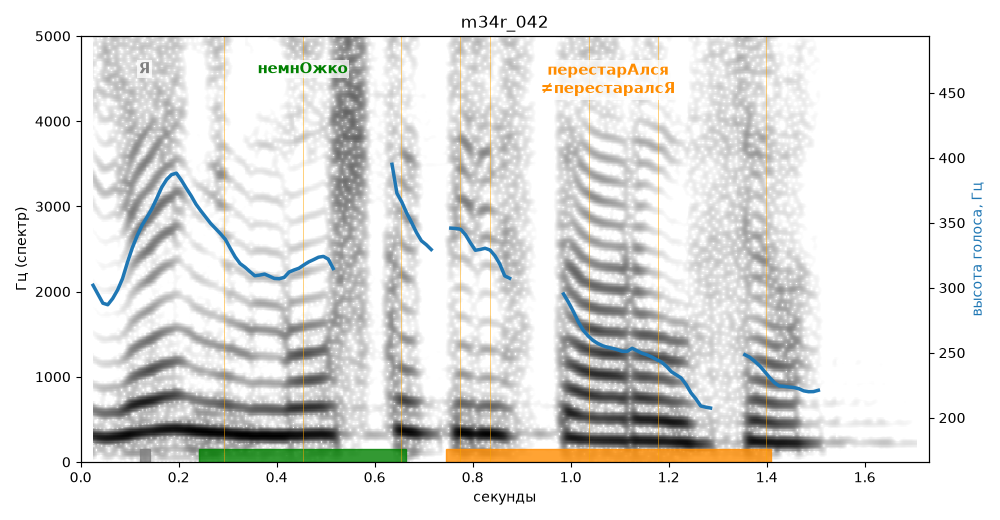

# m34r_042

Голос: **Рон (голос iPhone Milena), серия 34** · длительность 1.7 с
Эталон: Я немножко перестарался.
Распознано: Я немножко перестарался.
Слова: все совпали

## Ударения
(где нужно: ruaccent)

| слово | нужно | у голоса | |
|---|---|---|---|
| немножко | немнОжко | немнОжко | ✓ |
| перестарался | перестарАлся | перестаралсЯ | ✗? возможно — послушать |

## Интонация
- ✓ «я немножко перестарался.» — конец фразы понижается — звучит законченно
- Диапазон голоса 9.3 полутонов (живо), средняя высота 309 Гц

## Паузы и темп
- паузы на своих местах
- Темп 6.2 слога/с (нормально)

_Синяя линия — высота голоса. Над словами заглавная буква — где ударение должно быть; красным — голос поставил не туда (уверенно), оранжевым — возможно._
