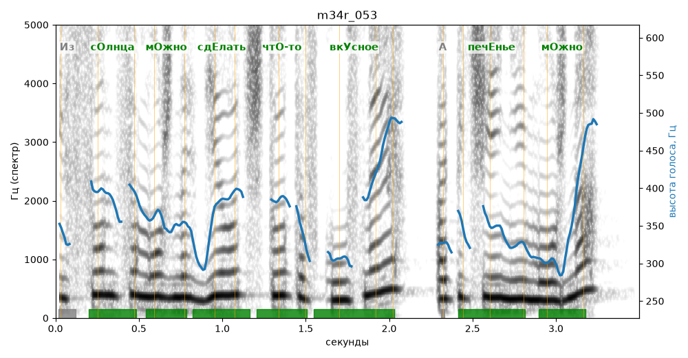

# m34r_053

Голос: **Рон (голос iPhone Milena), серия 34** · длительность 3.5 с
Эталон: Из солнца можно сделать что-то вкусное? А печенье можно?
Распознано: И сонца можно сделать что-то вкусное, а печенье можно.
Расхождения в словах: «из солнца» → «и сонца»

## Ударения
(где нужно: ruaccent)

| слово | нужно | у голоса | |
|---|---|---|---|
| солнца | сОлнца | сОлнца | ✓ |
| можно | мОжно | мОжно | ✓ |
| сделать | сдЕлать | сдЕлать | ✓ |
| что-то | чтО-то | чтО-то | ✓ |
| вкусное | вкУсное | вкУсное | ✓ |
| печенье | печЕнье | печЕнье | ✓ |
| можно | мОжно | мОжно | ✓ |

## Интонация
- ✗ «из солнца можно сделать что-то вкусное?» — нет вопросительного подъёма (самое высокое место — «солнца», в начале) — звучит как утверждение
- ✗ «а печенье можно?» — нет вопросительного подъёма (самое высокое место — «печенье», в начале) — звучит как утверждение
- Диапазон голоса 8.3 полутонов (живо), средняя высота 355 Гц

## Паузы и темп
- паузы на своих местах
- Темп 6.3 слога/с (нормально)

_Синяя линия — высота голоса. Над словами заглавная буква — где ударение должно быть; красным — голос поставил не туда (уверенно), оранжевым — возможно._
