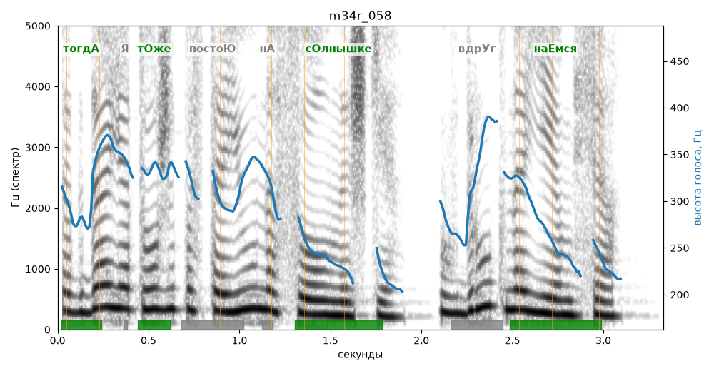

# m34r_058

Голос: **Рон (голос iPhone Milena), серия 34** · длительность 3.3 с
Эталон: Тогда я тоже постою на солнышке. Вдруг наемся.
Распознано: Тогда я тоже постаю на солнышке. Вдруг наьемся.
Расхождения в словах: «постою» → «постаю»; «наемся» → «наьемся»

## Ударения
(где нужно: ruaccent)

| слово | нужно | у голоса | |
|---|---|---|---|
| тогда | тогдА | тогдА | ✓ |
| тоже | тОже | тОже | ✓ |
| постою | постоЮ | — | ? |
| солнышке | сОлнышке | сОлнышке | ✓ |
| наемся | наЕмся | наЕмся | ✓ |

## Интонация
- ✓ «тогда я тоже постою на солнышке.» — конец фразы понижается — звучит законченно
- ✓ «вдруг наемся.» — конец фразы понижается — звучит законченно
- Диапазон голоса 9.1 полутонов (живо), средняя высота 292 Гц

## Паузы и темп
- паузы на своих местах
- Темп 5.4 слога/с (нормально)

_Синяя линия — высота голоса. Над словами заглавная буква — где ударение должно быть; красным — голос поставил не туда (уверенно), оранжевым — возможно._
