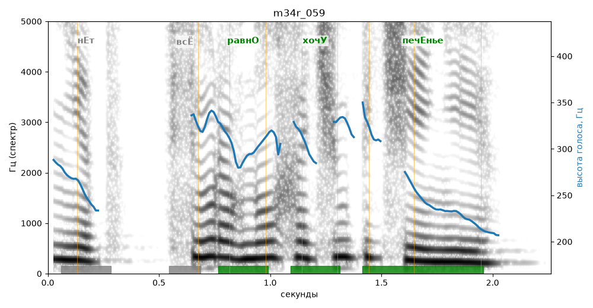

# m34r_059

Голос: **Рон (голос iPhone Milena), серия 34** · длительность 2.3 с
Эталон: Нет. Всё равно хочу печенье.
Распознано: Нет, всё равно хочу печенье.
Слова: все совпали

## Ударения
(где нужно: ruaccent)

| слово | нужно | у голоса | |
|---|---|---|---|
| равно | равнО | равнО | ✓ |
| хочу | хочУ | хочУ | ✓ |
| печенье | печЕнье | печЕнье | ✓ |

## Интонация
- ✓ «всё равно хочу печенье.» — конец фразы понижается — звучит законченно
- Диапазон голоса 7.9 полутонов (живо), средняя высота 286 Гц

## Паузы и темп
- паузы на своих местах
- Темп 5.5 слога/с (нормально)

_Синяя линия — высота голоса. Над словами заглавная буква — где ударение должно быть; красным — голос поставил не туда (уверенно), оранжевым — возможно._
