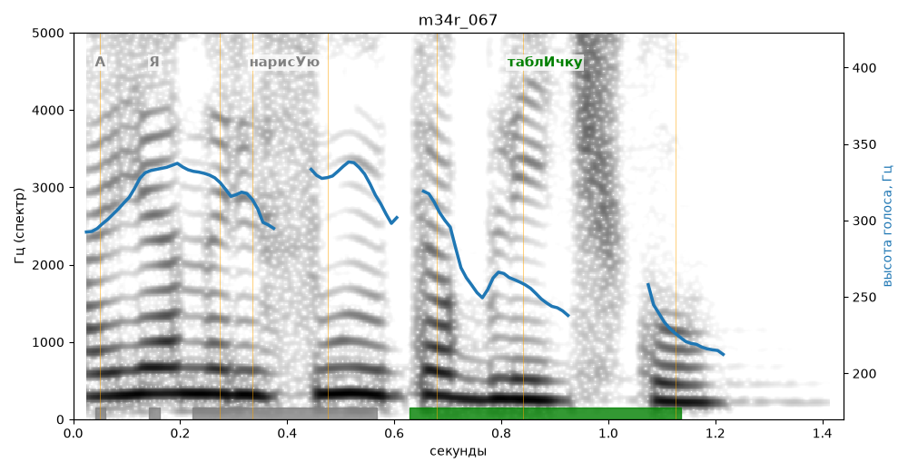

# m34r_067

Голос: **Рон (голос iPhone Milena), серия 34** · длительность 1.4 с
Эталон: А я нарисую табличку!
Распознано: А я нарисую табличку.
Слова: все совпали

## Ударения
(где нужно: ruaccent)

| слово | нужно | у голоса | |
|---|---|---|---|
| нарисую | нарисУю | — | ? |
| табличку | таблИчку | таблИчку | ✓ |

## Интонация
- ✗ «а я нарисую табличку!» — восклицание звучит ровно, без эмоции
- Диапазон голоса 7.4 полутонов (живо), средняя высота 301 Гц

## Паузы и темп
- паузы на своих местах
- Темп 6.4 слога/с (нормально)

_Синяя линия — высота голоса. Над словами заглавная буква — где ударение должно быть; красным — голос поставил не туда (уверенно), оранжевым — возможно._
