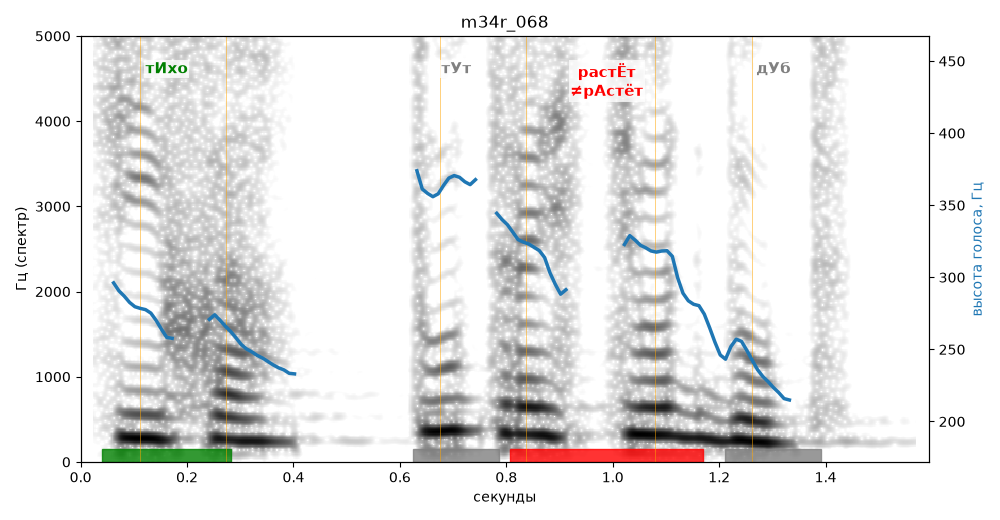

# m34r_068

Голос: **Рон (голос iPhone Milena), серия 34** · длительность 1.6 с
Эталон: Тихо! Тут растёт дуб!
Распознано: Сихо, тут растет дуд.
Расхождения в словах: «тихо» → «сихо»; «дуб» → «дуд»

## Ударения
(где нужно: ruaccent)

| слово | нужно | у голоса | |
|---|---|---|---|
| тихо | тИхо | тИхо | ✓ |
| растёт | растЁт | рАстёт | ✗ ОШИБКА |

## Интонация
- ✓ «тут растёт дуб!» — выделено слово «тут» (+2.3 пт)
- Диапазон голоса 8.2 полутонов (живо), средняя высота 281 Гц

## Паузы и темп
- паузы на своих местах
- Темп 5.9 слога/с (нормально)

_Синяя линия — высота голоса. Над словами заглавная буква — где ударение должно быть; красным — голос поставил не туда (уверенно), оранжевым — возможно._
