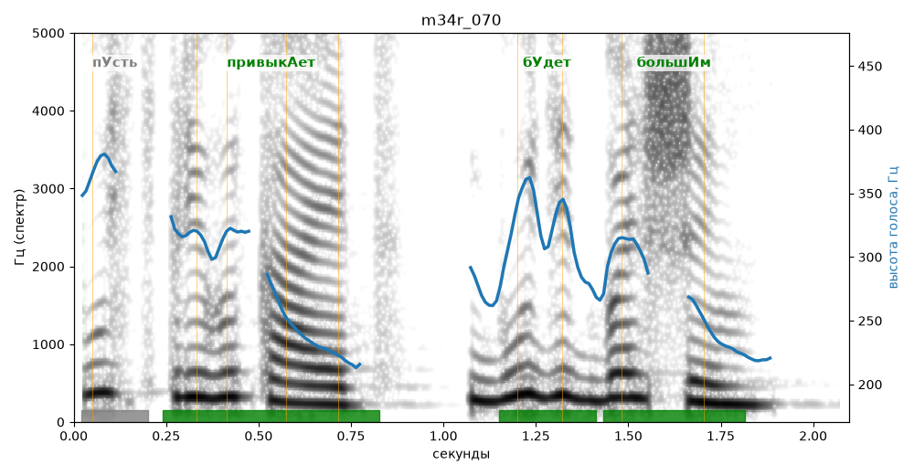

# m34r_070

Голос: **Рон (голос iPhone Milena), серия 34** · длительность 2.1 с
Эталон: Пусть привыкает. Будет большим.
Распознано: Пусть привыкает, будет большим.
Слова: все совпали

## Ударения
(где нужно: ruaccent)

| слово | нужно | у голоса | |
|---|---|---|---|
| привыкает | привыкАет | привыкАет | ✓ |
| будет | бУдет | бУдет | ✓ |
| большим | большИм | большИм | ✓ |

## Интонация
- ✓ «пусть привыкает.» — конец фразы понижается — звучит законченно
- ✓ «будет большим.» — конец фразы понижается — звучит законченно
- Диапазон голоса 8.8 полутонов (живо), средняя высота 290 Гц

## Паузы и темп
- паузы на своих местах
- Темп 6.1 слога/с (нормально)

_Синяя линия — высота голоса. Над словами заглавная буква — где ударение должно быть; красным — голос поставил не туда (уверенно), оранжевым — возможно._
