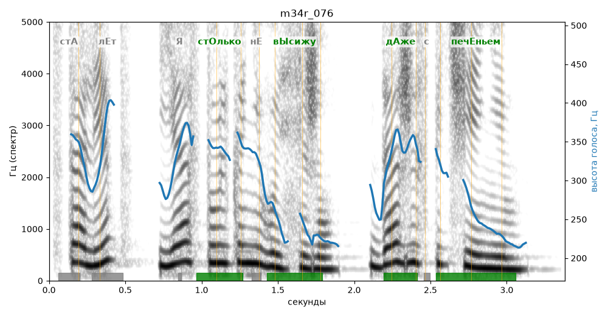

# m34r_076

Голос: **Рон (голос iPhone Milena), серия 34** · длительность 3.4 с
Эталон: Ста лет? Я столько не высижу. Даже с печеньем.
Распознано: Сталет, я столько не высижу, даже с печением.
Расхождения в словах: «ста лет» → «сталет»; «печеньем» → «печением»

## Ударения
(где нужно: ruaccent)

| слово | нужно | у голоса | |
|---|---|---|---|
| столько | стОлько | стОлько | ✓ |
| высижу | вЫсижу | вЫсижу | ✓ |
| даже | дАже | дАже | ✓ |
| печеньем | печЕньем | печЕньем | ✓ |

## Интонация
- ✓ «я столько не высижу.» — конец фразы понижается — звучит законченно
- ✓ «даже с печеньем.» — конец фразы понижается — звучит законченно
- Диапазон голоса 9.0 полутонов (живо), средняя высота 296 Гц

## Паузы и темп
- паузы на своих местах
- Темп 6.3 слога/с (нормально)

_Синяя линия — высота голоса. Над словами заглавная буква — где ударение должно быть; красным — голос поставил не туда (уверенно), оранжевым — возможно._
