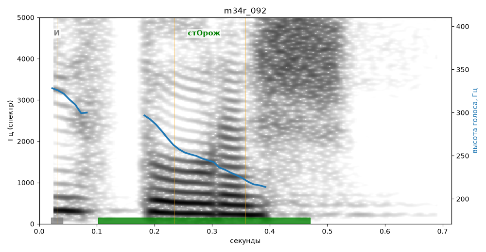

# m34r_092

Голос: **Рон (голос iPhone Milena), серия 34** · длительность 0.7 с
Эталон: И сторож!
Распознано: Исторыш.
Расхождения в словах: «и сторож» → «исторыш»

## Ударения
(где нужно: ruaccent)

| слово | нужно | у голоса | |
|---|---|---|---|
| сторож | стОрож | стОрож | ✓ |

## Интонация
- ✓ «и сторож!» — выделено слово «и» (+3.3 пт)
- Диапазон голоса 7.0 полутонов (живо), средняя высота 254 Гц

## Паузы и темп
- паузы на своих местах
- Темп 6.7 слога/с (быстро)

_Синяя линия — высота голоса. Над словами заглавная буква — где ударение должно быть; красным — голос поставил не туда (уверенно), оранжевым — возможно._
