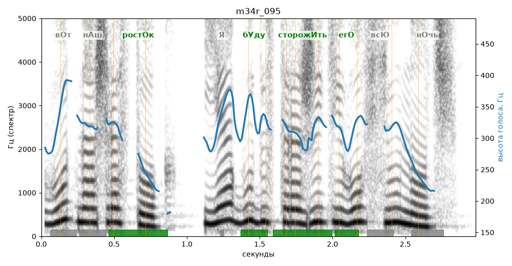

# m34r_095

Голос: **Рон (голос iPhone Milena), серия 34** · длительность 3.0 с
Эталон: Вот наш росток. Я буду сторожить его всю ночь.
Распознано: Вот наш росток, я буду строжить его всю ночь.
Расхождения в словах: «сторожить» → «строжить»

## Ударения
(где нужно: ruaccent)

| слово | нужно | у голоса | |
|---|---|---|---|
| росток | ростОк | ростОк | ✓ |
| буду | бУду | бУду | ✓ |
| сторожить | сторожИть | сторожИть | ✓ |
| его | егО | егО | ✓ |

## Интонация
- ✓ «вот наш росток.» — конец фразы понижается — звучит законченно
- ✓ «я буду сторожить его всю ночь.» — конец фразы понижается — звучит законченно
- Диапазон голоса 9.1 полутонов (живо), средняя высота 314 Гц

## Паузы и темп
- паузы на своих местах
- Темп 5.6 слога/с (нормально)

_Синяя линия — высота голоса. Над словами заглавная буква — где ударение должно быть; красным — голос поставил не туда (уверенно), оранжевым — возможно._
