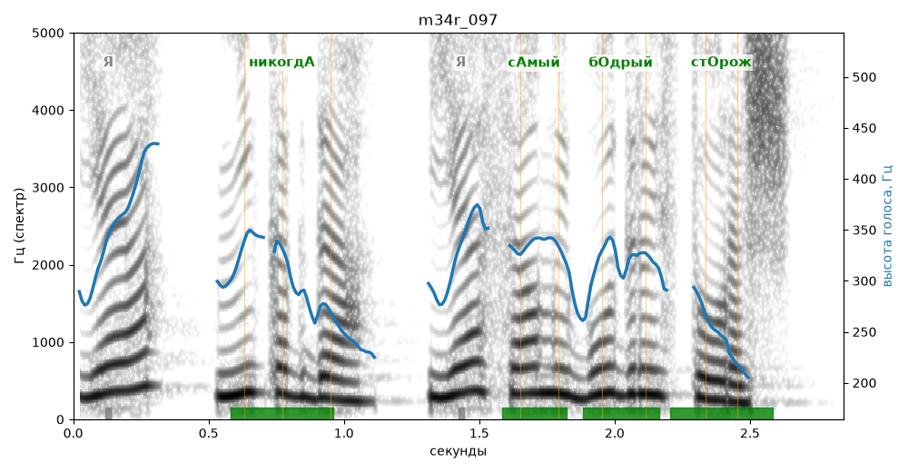

# m34r_097

Голос: **Рон (голос iPhone Milena), серия 34** · длительность 2.8 с
Эталон: Я? Никогда. Я самый бодрый сторож.
Распознано: Я, никогда, я самый будрый сторож.
Расхождения в словах: «бодрый» → «будрый»

## Ударения
(где нужно: ruaccent)

| слово | нужно | у голоса | |
|---|---|---|---|
| никогда | никогдА | никогдА | ✓ |
| самый | сАмый | сАмый | ✓ |
| бодрый | бОдрый | бОдрый | ✓ |
| сторож | стОрож | стОрож | ✓ |

## Интонация
- ✓ «никогда.» — конец фразы понижается — звучит законченно
- ✓ «я самый бодрый сторож.» — конец фразы понижается — звучит законченно
- Диапазон голоса 8.9 полутонов (живо), средняя высота 313 Гц

## Паузы и темп
- паузы на своих местах
- Темп 5.8 слога/с (нормально)

_Синяя линия — высота голоса. Над словами заглавная буква — где ударение должно быть; красным — голос поставил не туда (уверенно), оранжевым — возможно._
