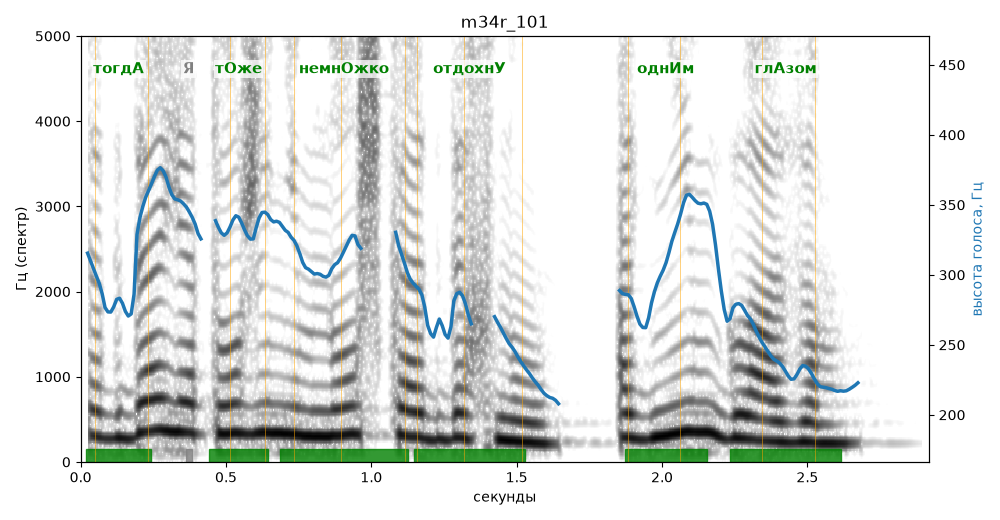

# m34r_101

Голос: **Рон (голос iPhone Milena), серия 34** · длительность 2.9 с
Эталон: Тогда я тоже немножко отдохну. Одним глазом.
Распознано: Тогда я тоже немножко отдохну, одним глазом.
Слова: все совпали

## Ударения
(где нужно: ruaccent)

| слово | нужно | у голоса | |
|---|---|---|---|
| тогда | тогдА | тогдА | ✓ |
| тоже | тОже | тОже | ✓ |
| немножко | немнОжко | немнОжко | ✓ |
| отдохну | отдохнУ | отдохнУ | ✓ |
| одним | однИм | однИм | ✓ |
| глазом | глАзом | глАзом | ✓ |

## Интонация
- ✓ «тогда я тоже немножко отдохну.» — конец фразы понижается — звучит законченно
- ✓ «одним глазом.» — конец фразы понижается — звучит законченно
- Диапазон голоса 8.5 полутонов (живо), средняя высота 288 Гц

## Паузы и темп
- паузы на своих местах
- Темп 6.2 слога/с (нормально)

_Синяя линия — высота голоса. Над словами заглавная буква — где ударение должно быть; красным — голос поставил не туда (уверенно), оранжевым — возможно._
