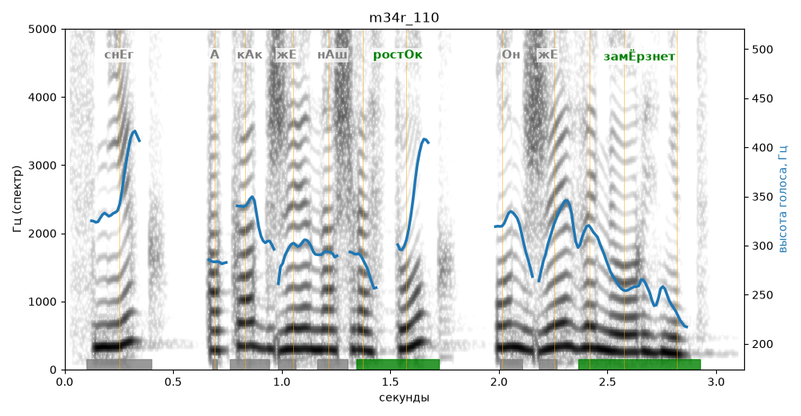

# m34r_110

Голос: **Рон (голос iPhone Milena), серия 34** · длительность 3.1 с
Эталон: Снег? А как же наш росток? Он же замёрзнет!
Распознано: Сник, а как же наш росток, он же замерзнет.
Расхождения в словах: «снег» → «сник»

## Ударения
(где нужно: ruaccent)

| слово | нужно | у голоса | |
|---|---|---|---|
| росток | ростОк | ростОк | ✓ |
| замёрзнет | замЁрзнет | замЁрзнет | ✓ |

## Интонация
- ✗ «а как же наш росток?» — нет вопросительного подъёма (самое высокое место — «росток», в начале) — звучит как утверждение
- ✗ «он же замёрзнет!» — восклицание звучит ровно, без эмоции
- Диапазон голоса 8.5 полутонов (живо), средняя высота 300 Гц

## Паузы и темп
- паузы на своих местах
- Темп 5.3 слога/с (нормально)

_Синяя линия — высота голоса. Над словами заглавная буква — где ударение должно быть; красным — голос поставил не туда (уверенно), оранжевым — возможно._
