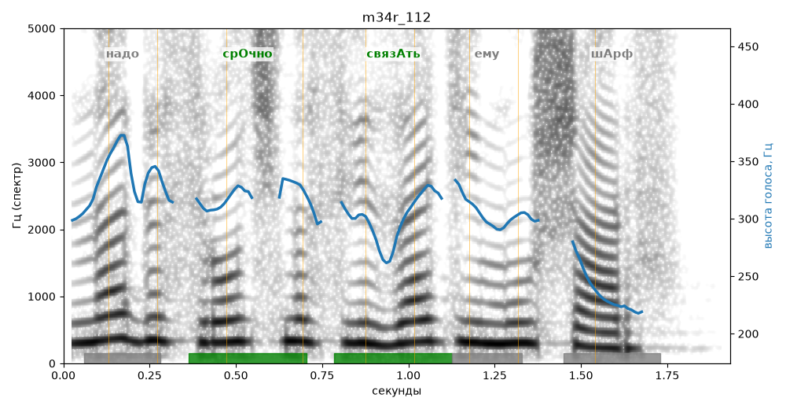

# m34r_112

Голос: **Рон (голос iPhone Milena), серия 34** · длительность 1.9 с
Эталон: Надо срочно связать ему шарф!
Распознано: Надо срочно связать ему шарф.
Слова: все совпали

## Ударения
(где нужно: ruaccent)

| слово | нужно | у голоса | |
|---|---|---|---|
| надо | надо | нАдо | нет эталона |
| срочно | срОчно | срОчно | ✓ |
| связать | связАть | связАть | ✓ |
| ему | ему | емУ | нет эталона |

## Интонация
- ✗ «надо срочно связать ему шарф!» — восклицание звучит ровно, без эмоции
- Диапазон голоса 7.5 полутонов (живо), средняя высота 308 Гц

## Паузы и темп
- паузы на своих местах
- Темп 5.4 слога/с (нормально)

_Синяя линия — высота голоса. Над словами заглавная буква — где ударение должно быть; красным — голос поставил не туда (уверенно), оранжевым — возможно._
