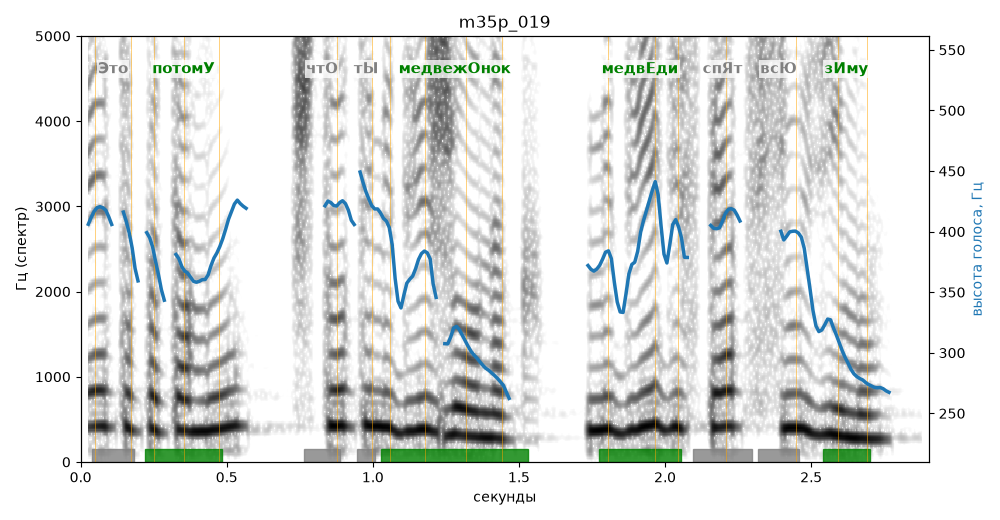

# m35p_019

Голос: **Пик (голос iPhone Milena), серия 35** · длительность 2.9 с
Эталон: Это потому, что ты медвежонок. Медведи спят всю зиму!
Распознано: Это потому, что ты мне движонок, мне длине с 5 семьями.
Расхождения в словах: «медвежонок медведи спят всю зиму» → «мне движонок мне длине с 5 семьями»

## Ударения
(где нужно: ruaccent)

| слово | нужно | у голоса | |
|---|---|---|---|
| это | Это | этО | ? не разобрать |
| потому | потомУ | потомУ | ✓ |
| медвежонок | медвежОнок | медвежОнок | ✓ |
| медведи | медвЕди | медвЕди | ✓ |
| зиму | зИму | зИму | ✓ |

## Интонация
- ✓ «это потому что ты медвежонок.» — конец фразы понижается — звучит законченно
- ✗ «медведи спят всю зиму!» — восклицание звучит ровно, без эмоции
- Диапазон голоса 7.6 полутонов (живо), средняя высота 377 Гц

## Паузы и темп
- паузы на своих местах
- Темп 8.4 слога/с (быстро)

_Синяя линия — высота голоса. Над словами заглавная буква — где ударение должно быть; красным — голос поставил не туда (уверенно), оранжевым — возможно._
