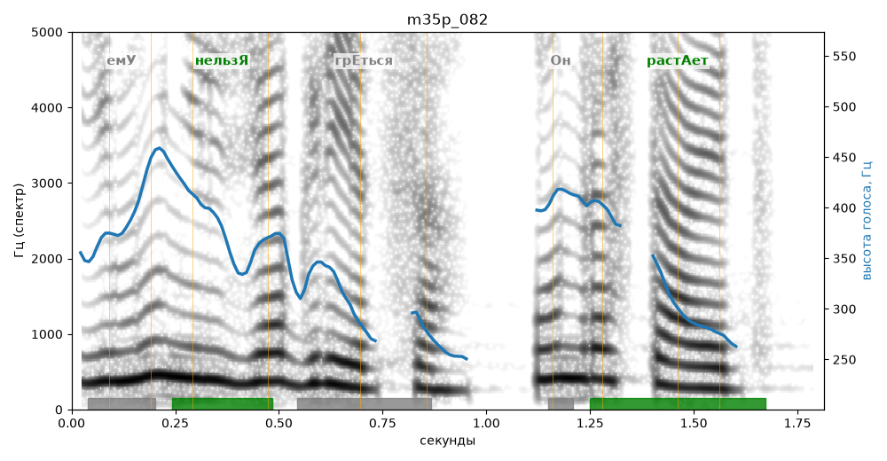

# m35p_082

Голос: **Пик (голос iPhone Milena), серия 35** · длительность 1.8 с
Эталон: Ему нельзя греться. Он растает.
Распознано: Ему нельзя греться, он расстает.
Расхождения в словах: «растает» → «расстает»

## Ударения
(где нужно: ruaccent)

| слово | нужно | у голоса | |
|---|---|---|---|
| ему | емУ | Ему | ? не разобрать |
| нельзя | нельзЯ | нельзЯ | ✓ |
| греться | грЕться | гретьсЯ | ? не разобрать |
| растает | растАет | растАет | ✓ |

## Интонация
- ✓ «ему нельзя греться.» — конец фразы понижается — звучит законченно
- ✓ «он растает.» — конец фразы понижается — звучит законченно
- Диапазон голоса 8.9 полутонов (живо), средняя высота 352 Гц

## Паузы и темп
- паузы на своих местах
- Темп 7.4 слога/с (быстро)

_Синяя линия — высота голоса. Над словами заглавная буква — где ударение должно быть; красным — голос поставил не туда (уверенно), оранжевым — возможно._
