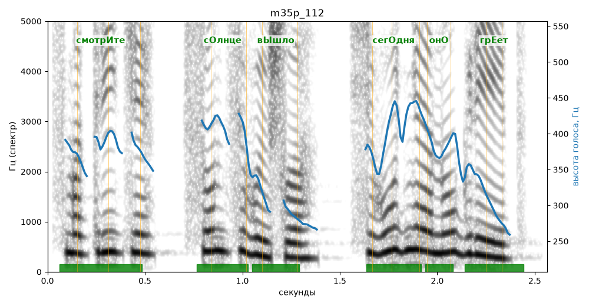

# m35p_112

Голос: **Пик (голос iPhone Milena), серия 35** · длительность 2.6 с
Эталон: Смотрите, солнце вышло! Сегодня оно греет.
Распознано: Смотрите, солнце вышло, сегодня оно греет.
Слова: все совпали

## Ударения
(где нужно: ruaccent)

| слово | нужно | у голоса | |
|---|---|---|---|
| смотрите | смотрИте | смотрИте | ✓ |
| солнце | сОлнце | сОлнце | ✓ |
| вышло | вЫшло | вЫшло | ✓ |
| сегодня | сегОдня | сегОдня | ✓ |
| оно | онО | онО | ✓ |
| греет | грЕет | грЕет | ✓ |

## Интонация
- ✗ «смотрите солнце вышло!» — восклицание звучит ровно, без эмоции
- ✓ «сегодня оно греет.» — конец фразы понижается — звучит законченно
- Диапазон голоса 8.2 полутонов (живо), средняя высота 374 Гц

## Паузы и темп
- паузы на своих местах
- Темп 8.0 слога/с (быстро)

_Синяя линия — высота голоса. Над словами заглавная буква — где ударение должно быть; красным — голос поставил не туда (уверенно), оранжевым — возможно._
