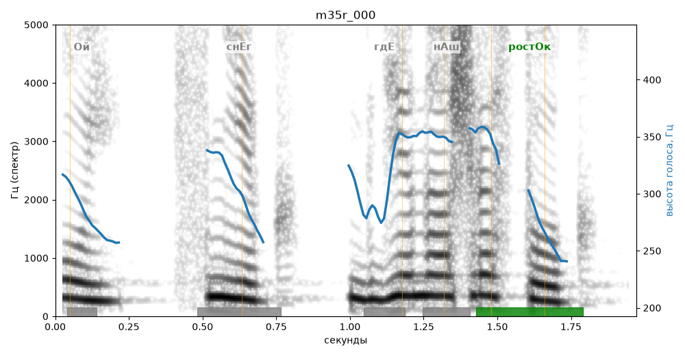

# m35r_000

Голос: **Рон (голос iPhone Milena), серия 35** · длительность 2.0 с
Эталон: Ой! Снег! Где наш росток?
Распознано: Ой, снег, где наш росток?
Слова: все совпали

## Ударения
(где нужно: ruaccent)

| слово | нужно | у голоса | |
|---|---|---|---|
| росток | ростОк | ростОк | ✓ |

## Интонация
- ✓ «где наш росток?» — конец фразы понижается — звучит законченно
- Диапазон голоса 5.8 полутонов (нормально), средняя высота 304 Гц

## Паузы и темп
- паузы на своих местах
- Темп 5.3 слога/с (нормально)

_Синяя линия — высота голоса. Над словами заглавная буква — где ударение должно быть; красным — голос поставил не туда (уверенно), оранжевым — возможно._
