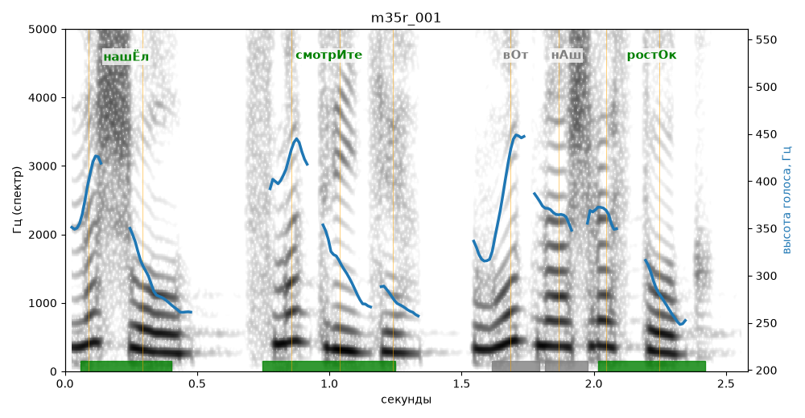

# m35r_001

Голос: **Рон (голос iPhone Milena), серия 35** · длительность 2.6 с
Эталон: Нашёл! Смотрите! Вот наш росток!
Распознано: Нашел, смотрите, вот наш росток.
Слова: все совпали

## Ударения
(где нужно: ruaccent)

| слово | нужно | у голоса | |
|---|---|---|---|
| нашёл | нашЁл | нашЁл | ✓ |
| смотрите | смотрИте | смотрИте | ✓ |
| росток | ростОк | ростОк | ✓ |

## Интонация
- ✗ «смотрите!» — восклицание звучит ровно, без эмоции
- ✗ «вот наш росток!» — восклицание звучит ровно, без эмоции
- Диапазон голоса 9.1 полутонов (живо), средняя высота 328 Гц

## Паузы и темп
- паузы на своих местах
- Темп 5.4 слога/с (нормально)

_Синяя линия — высота голоса. Над словами заглавная буква — где ударение должно быть; красным — голос поставил не туда (уверенно), оранжевым — возможно._
