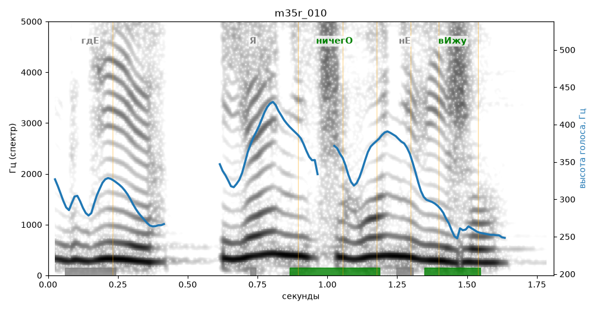

# m35r_010

Голос: **Рон (голос iPhone Milena), серия 35** · длительность 1.8 с
Эталон: Где? Я ничего не вижу.
Распознано: Где? Я ничего не вижу.
Слова: все совпали

## Ударения
(где нужно: ruaccent)

| слово | нужно | у голоса | |
|---|---|---|---|
| ничего | ничегО | ничегО | ✓ |
| вижу | вИжу | вИжу | ✓ |

## Интонация
- ✓ «я ничего не вижу.» — конец фразы понижается — звучит законченно
- Диапазон голоса 8.3 полутонов (живо), средняя высота 322 Гц

## Паузы и темп
- паузы на своих местах
- Темп 7.0 слога/с (быстро)

_Синяя линия — высота голоса. Над словами заглавная буква — где ударение должно быть; красным — голос поставил не туда (уверенно), оранжевым — возможно._
