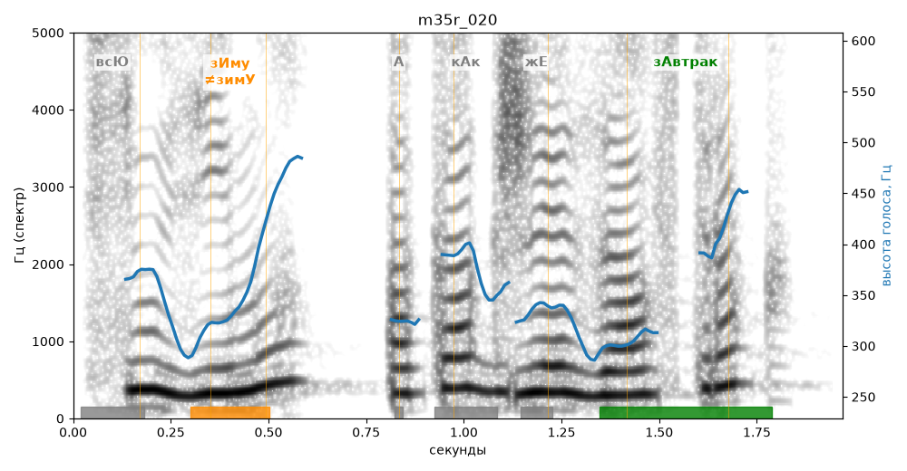

# m35r_020

Голос: **Рон (голос iPhone Milena), серия 35** · длительность 2.0 с
Эталон: Всю зиму? А как же завтрак?
Распознано: Сюзимо, а как же завтрак?
Расхождения в словах: «всю зиму» → «сюзимо»

## Ударения
(где нужно: ruaccent)

| слово | нужно | у голоса | |
|---|---|---|---|
| зиму | зИму | зимУ | ✗? возможно — послушать |
| завтрак | зАвтрак | зАвтрак | ✓ |

## Интонация
- ✗ «всю зиму?» — нет вопросительного подъёма (самое высокое место — «всю», в начале) — звучит как утверждение
- ✗ «а как же завтрак?» — нет вопросительного подъёма (самое высокое место — «как», в начале) — звучит как утверждение
- Диапазон голоса 7.8 полутонов (живо), средняя высота 340 Гц

## Паузы и темп
- паузы на своих местах
- Темп 5.5 слога/с (нормально)

_Синяя линия — высота голоса. Над словами заглавная буква — где ударение должно быть; красным — голос поставил не туда (уверенно), оранжевым — возможно._
