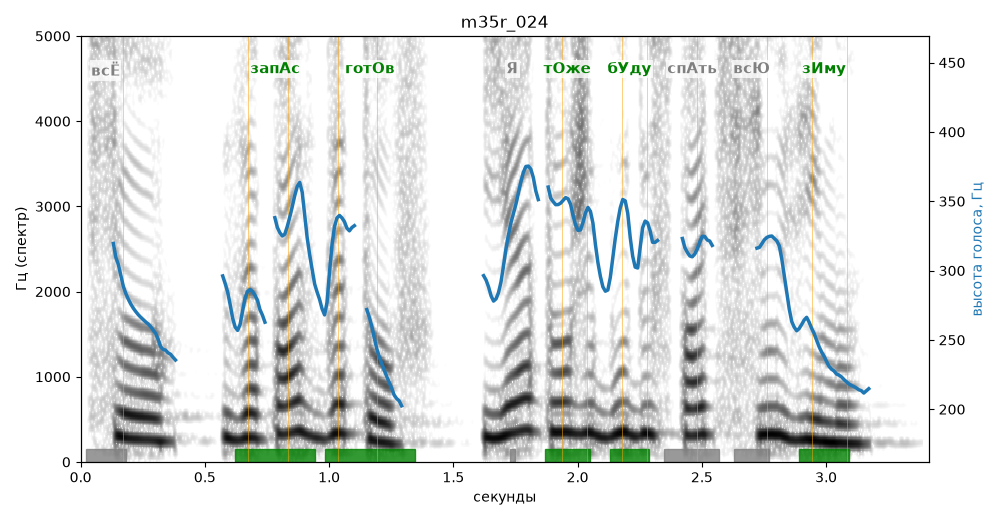

# m35r_024

Голос: **Рон (голос iPhone Milena), серия 35** · длительность 3.4 с
Эталон: Всё! Запас готов. Я тоже буду спать всю зиму!
Распознано: Все, запас готов, я тоже буду спать всю зиму.
Слова: все совпали

## Ударения
(где нужно: ruaccent)

| слово | нужно | у голоса | |
|---|---|---|---|
| запас | запАс | запАс | ✓ |
| готов | готОв | готОв | ✓ |
| тоже | тОже | тОже | ✓ |
| буду | бУду | бУду | ✓ |
| зиму | зИму | зИму | ✓ |

## Интонация
- ✓ «запас готов.» — конец фразы понижается — звучит законченно
- ✗ «я тоже буду спать всю зиму!» — восклицание звучит ровно, без эмоции
- Диапазон голоса 8.6 полутонов (живо), средняя высота 297 Гц

## Паузы и темп
- паузы на своих местах
- Темп 5.8 слога/с (нормально)

_Синяя линия — высота голоса. Над словами заглавная буква — где ударение должно быть; красным — голос поставил не туда (уверенно), оранжевым — возможно._
