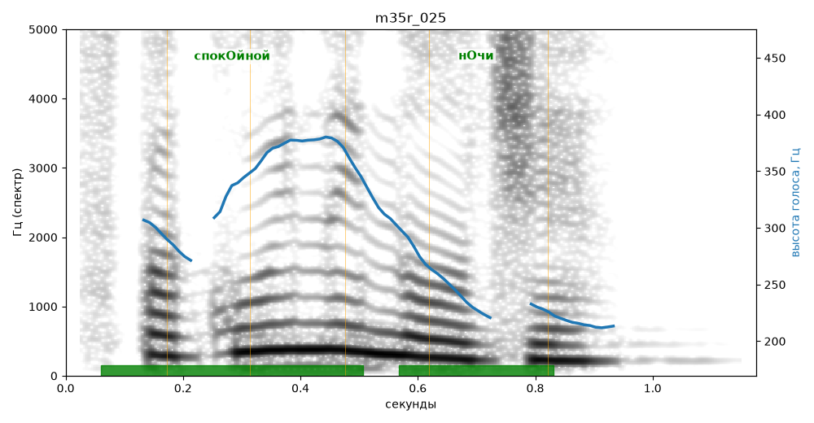

# m35r_025

Голос: **Рон (голос iPhone Milena), серия 35** · длительность 1.2 с
Эталон: Спокойной ночи!
Распознано: Спокойной ночи.
Слова: все совпали

## Ударения
(где нужно: ruaccent)

| слово | нужно | у голоса | |
|---|---|---|---|
| спокойной | спокОйной | спокОйной | ✓ |
| ночи | нОчи | нОчи | ✓ |

## Интонация
- ✓ «спокойной ночи!» — выделено слово «спокойной» (+3.4 пт)
- Диапазон голоса 9.9 полутонов (живо), средняя высота 296 Гц

## Паузы и темп
- паузы на своих местах
- Темп 6.5 слога/с (нормально)

_Синяя линия — высота голоса. Над словами заглавная буква — где ударение должно быть; красным — голос поставил не туда (уверенно), оранжевым — возможно._
