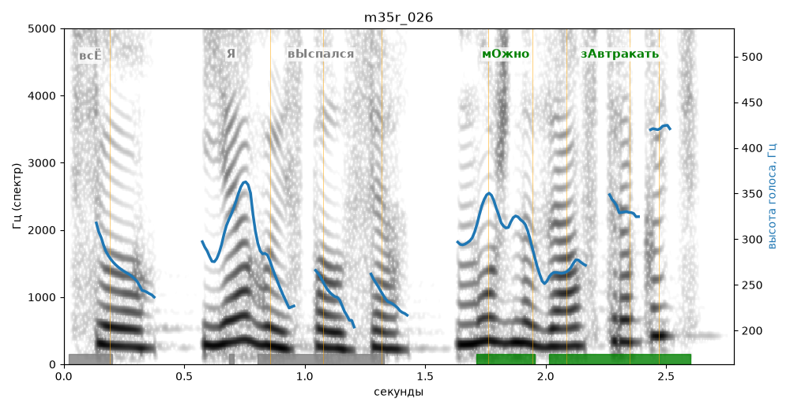

# m35r_026

Голос: **Рон (голос iPhone Milena), серия 35** · длительность 2.8 с
Эталон: Всё! Я выспался! Можно завтракать?
Распознано: Всё, я выступал всё, можно завтракать?
Расхождения в словах: «выспался» → «выступал все»

## Ударения
(где нужно: ruaccent)

| слово | нужно | у голоса | |
|---|---|---|---|
| выспался | вЫспался | выспалсЯ | ? не разобрать |
| можно | мОжно | мОжно | ✓ |
| завтракать | зАвтракать | зАвтракать | ✓ |

## Интонация
- ✓ «я выспался!» — выделено слово «выспался» (+2.8 пт)
- ✗ «можно завтракать?» — нет вопросительного подъёма (самое высокое место — «можно», в начале) — звучит как утверждение
- Диапазон голоса 9.4 полутонов (живо), средняя высота 279 Гц

## Паузы и темп
- паузы на своих местах
- Темп 5.3 слога/с (нормально)

_Синяя линия — высота голоса. Над словами заглавная буква — где ударение должно быть; красным — голос поставил не туда (уверенно), оранжевым — возможно._
