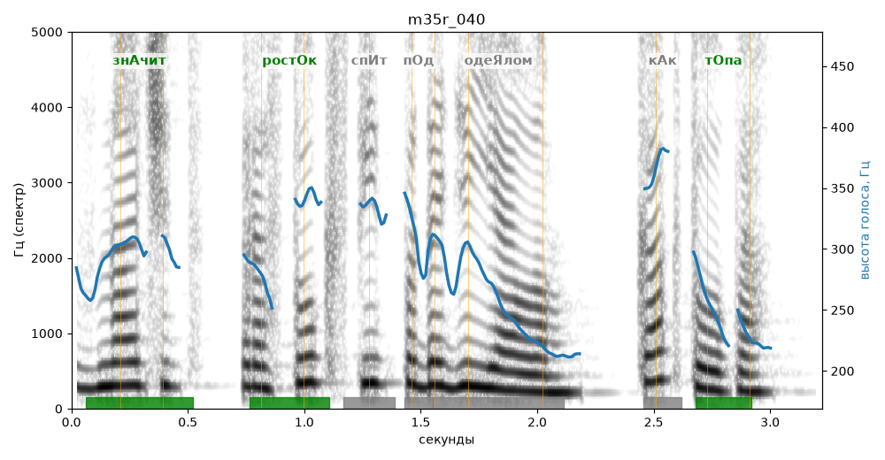

# m35r_040

Голос: **Рон (голос iPhone Milena), серия 35** · длительность 3.2 с
Эталон: Значит, росток спит под одеялом. Как Топа!
Распознано: Значит, росток с пид пододиялом, как топа?
Расхождения в словах: «спит под одеялом» → «с пид пододиялом»

## Ударения
(где нужно: ruaccent)

| слово | нужно | у голоса | |
|---|---|---|---|
| значит | знАчит | знАчит | ✓ |
| росток | ростОк | ростОк | ✓ |
| одеялом | одеЯлом | — | ? |
| топа | тОпа | тОпа | ✓ |

## Интонация
- ✓ «значит росток спит под одеялом.» — конец фразы понижается — звучит законченно
- ✓ «как топа!» — выделено слово «как» (+6.4 пт)
- Диапазон голоса 8.5 полутонов (живо), средняя высота 284 Гц

## Паузы и темп
- паузы на своих местах
- Темп 5.3 слога/с (нормально)

_Синяя линия — высота голоса. Над словами заглавная буква — где ударение должно быть; красным — голос поставил не туда (уверенно), оранжевым — возможно._
