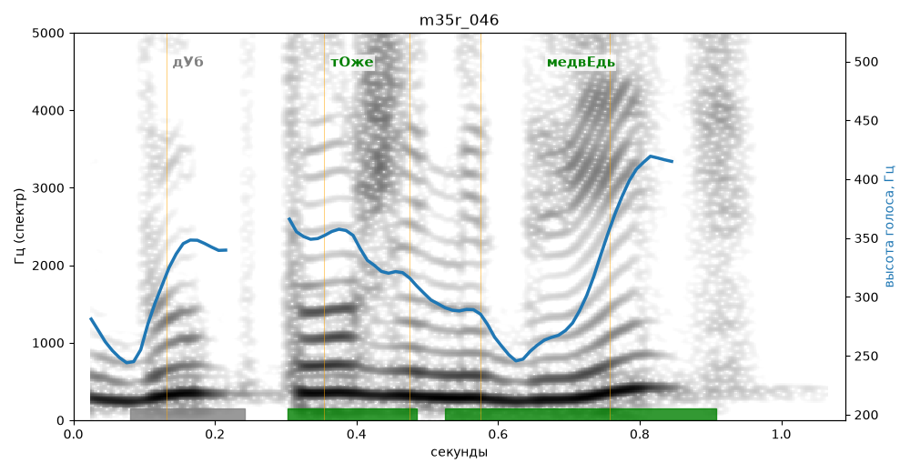

# m35r_046

Голос: **Рон (голос iPhone Milena), серия 35** · длительность 1.1 с
Эталон: Дуб тоже медведь?
Распознано: Дуб тоже медведь.
Слова: все совпали

## Ударения
(где нужно: ruaccent)

| слово | нужно | у голоса | |
|---|---|---|---|
| тоже | тОже | тОже | ✓ |
| медведь | медвЕдь | медвЕдь | ✓ |

## Интонация
- ✗ «дуб тоже медведь?» — нет вопросительного подъёма (самое высокое место — «медведь», в начале) — звучит как утверждение
- Диапазон голоса 8.9 полутонов (живо), средняя высота 317 Гц

## Паузы и темп
- паузы на своих местах
- Темп 6.0 слога/с (нормально)

_Синяя линия — высота голоса. Над словами заглавная буква — где ударение должно быть; красным — голос поставил не туда (уверенно), оранжевым — возможно._
