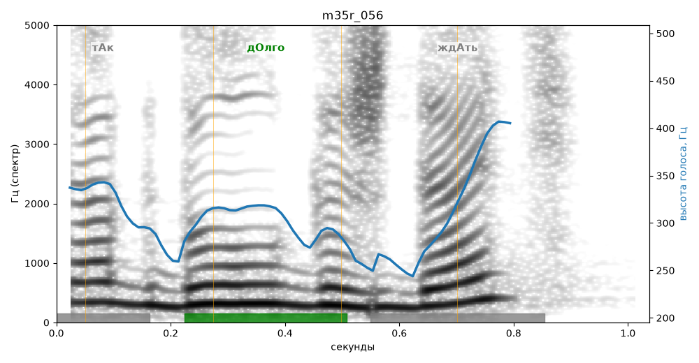

# m35r_056

Голос: **Рон (голос iPhone Milena), серия 35** · длительность 1.0 с
Эталон: Так долго ждать?
Распознано: так долго ждать.
Слова: все совпали

## Ударения
(где нужно: ruaccent)

| слово | нужно | у голоса | |
|---|---|---|---|
| долго | дОлго | дОлго | ✓ |

## Интонация
- ✗ «так долго ждать?» — нет вопросительного подъёма (самое высокое место — «так», в начале) — звучит как утверждение
- Диапазон голоса 7.8 полутонов (живо), средняя высота 300 Гц

## Паузы и темп
- паузы на своих местах
- Темп 4.7 слога/с (нормально)

_Синяя линия — высота голоса. Над словами заглавная буква — где ударение должно быть; красным — голос поставил не туда (уверенно), оранжевым — возможно._
