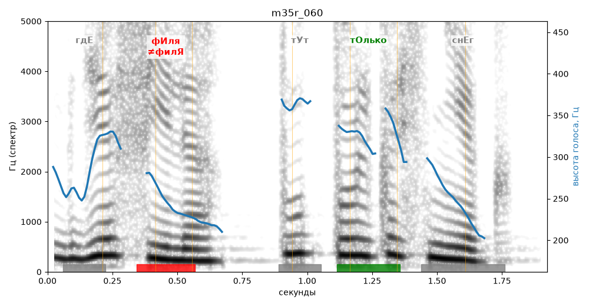

# m35r_060

Голос: **Рон (голос iPhone Milena), серия 35** · длительность 1.9 с
Эталон: Где Филя? Тут только снег!
Распознано: Где Фила, тут только снег.
Расхождения в словах: «филя» → «фила»

## Ударения
(где нужно: ruaccent)

| слово | нужно | у голоса | |
|---|---|---|---|
| филя | фИля | филЯ | ✗ ОШИБКА |
| только | тОлько | тОлько | ✓ |

## Интонация
- ✗ «где филя?» — конец фразы не понижается — звучит незаконченно / как перечисление
- ✓ «тут только снег!» — выделено слово «тут» (+2.1 пт)
- Диапазон голоса 9.2 полутонов (живо), средняя высота 277 Гц

## Паузы и темп
- паузы на своих местах
- Темп 5.1 слога/с (нормально)

_Синяя линия — высота голоса. Над словами заглавная буква — где ударение должно быть; красным — голос поставил не туда (уверенно), оранжевым — возможно._
