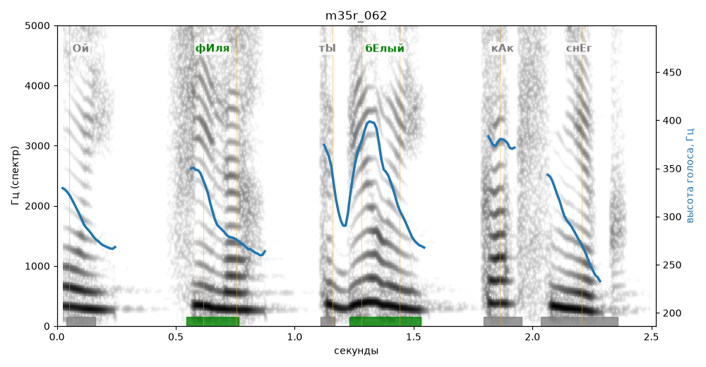

# m35r_062

Голос: **Рон (голос iPhone Milena), серия 35** · длительность 2.5 с
Эталон: Ой! Филя! Ты белый, как снег!
Распознано: Ой, Фила, ты белый, как снег!
Расхождения в словах: «филя» → «фила»

## Ударения
(где нужно: ruaccent)

| слово | нужно | у голоса | |
|---|---|---|---|
| филя | фИля | фИля | ✓ |
| белый | бЕлый | бЕлый | ✓ |

## Интонация
- ✓ «ты белый как снег!» — выделено слово «белый» (+2.6 пт)
- Диапазон голоса 6.6 полутонов (нормально), средняя высота 303 Гц

## Паузы и темп
- паузы на своих местах
- Темп 6.0 слога/с (нормально)

_Синяя линия — высота голоса. Над словами заглавная буква — где ударение должно быть; красным — голос поставил не туда (уверенно), оранжевым — возможно._
