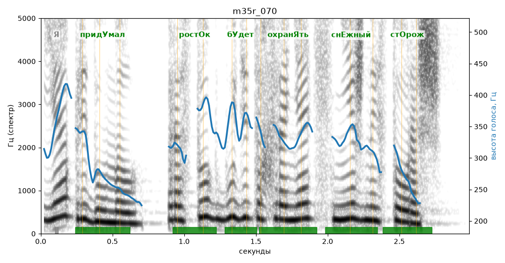

# m35r_070

Голос: **Рон (голос iPhone Milena), серия 35** · длительность 3.0 с
Эталон: Я придумал! Росток будет охранять снежный сторож!
Распознано: Я придумал, просток будет охранять снежный сторож.
Расхождения в словах: «росток» → «просток»

## Ударения
(где нужно: ruaccent)

| слово | нужно | у голоса | |
|---|---|---|---|
| придумал | придУмал | придУмал | ✓ |
| росток | ростОк | ростОк | ✓ |
| будет | бУдет | бУдет | ✓ |
| охранять | охранЯть | охранЯть | ✓ |
| снежный | снЕжный | снЕжный | ✓ |
| сторож | стОрож | стОрож | ✓ |

## Интонация
- ✗ «я придумал!» — восклицание звучит ровно, без эмоции
- ✓ «росток будет охранять снежный сторож!» — выделено слово «росток» (+2.4 пт)
- Диапазон голоса 8.8 полутонов (живо), средняя высота 322 Гц

## Паузы и темп
- паузы на своих местах
- Темп 6.0 слога/с (нормально)

_Синяя линия — высота голоса. Над словами заглавная буква — где ударение должно быть; красным — голос поставил не туда (уверенно), оранжевым — возможно._
