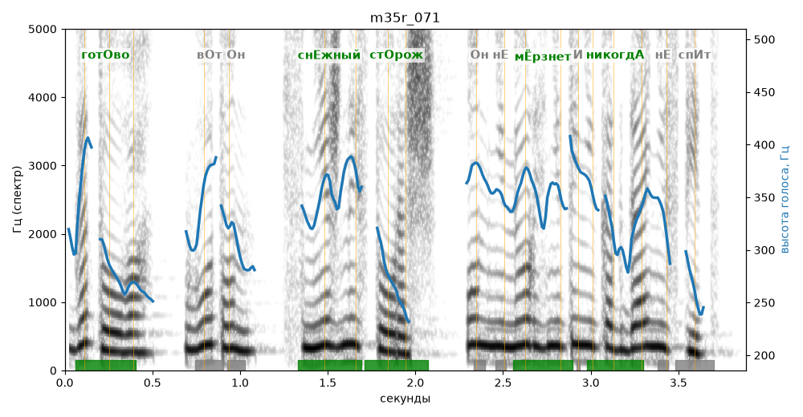

# m35r_071

Голос: **Рон (голос iPhone Milena), серия 35** · длительность 3.9 с
Эталон: Готово! Вот он, снежный сторож! Он не мёрзнет и никогда не спит!
Распознано: Готово! Вот он, снежный сторож, он не нерзнет и никогда не спит.
Расхождения в словах: «мерзнет» → «нерзнет»

## Ударения
(где нужно: ruaccent)

| слово | нужно | у голоса | |
|---|---|---|---|
| готово | готОво | готОво | ✓ |
| снежный | снЕжный | снЕжный | ✓ |
| сторож | стОрож | стОрож | ✓ |
| мёрзнет | мЁрзнет | мЁрзнет | ✓ |
| никогда | никогдА | никогдА | ✓ |

## Интонация
- ✗ «готово!» — восклицание звучит ровно, без эмоции
- ✗ «вот он снежный сторож!» — восклицание звучит ровно, без эмоции
- ✗ «он не мёрзнет и никогда не спит!» — восклицание звучит ровно, без эмоции
- Диапазон голоса 7.2 полутонов (живо), средняя высота 337 Гц

## Паузы и темп
- паузы на своих местах
- Темп 6.9 слога/с (быстро)

_Синяя линия — высота голоса. Над словами заглавная буква — где ударение должно быть; красным — голос поставил не туда (уверенно), оранжевым — возможно._
