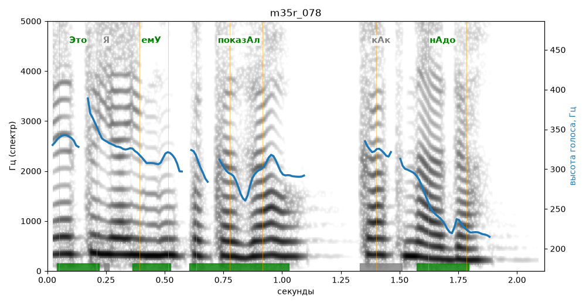

# m35r_078

Голос: **Рон (голос iPhone Milena), серия 35** · длительность 2.1 с
Эталон: Это я ему показал, как надо.
Распознано: Это я ему показал, как надо.
Слова: все совпали

## Ударения
(где нужно: ruaccent)

| слово | нужно | у голоса | |
|---|---|---|---|
| это | Это | Это | ✓ |
| ему | емУ | емУ | ✓ |
| показал | показАл | показАл | ✓ |
| надо | нАдо | нАдо | ✓ |

## Интонация
- ✓ «это я ему показал как надо.» — конец фразы понижается — звучит законченно
- Диапазон голоса 7.6 полутонов (живо), средняя высота 306 Гц

## Паузы и темп
- паузы на своих местах
- Темп 6.9 слога/с (быстро)

_Синяя линия — высота голоса. Над словами заглавная буква — где ударение должно быть; красным — голос поставил не туда (уверенно), оранжевым — возможно._
