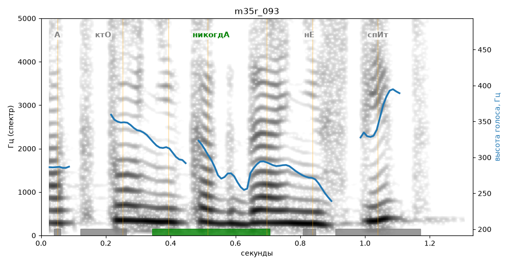

# m35r_093

Голос: **Рон (голос iPhone Milena), серия 35** · длительность 1.3 с
Эталон: А кто никогда не спит?
Распознано: а кто никогда не спит?
Слова: все совпали

## Ударения
(где нужно: ruaccent)

| слово | нужно | у голоса | |
|---|---|---|---|
| никогда | никогдА | никогдА | ✓ |

## Интонация
- ✓ «а кто никогда не спит?» — вопросительный подъём на слове «спит»
- Диапазон голоса 6.9 полутонов (нормально), средняя высота 294 Гц

## Паузы и темп
- паузы на своих местах
- Темп 6.2 слога/с (нормально)

_Синяя линия — высота голоса. Над словами заглавная буква — где ударение должно быть; красным — голос поставил не туда (уверенно), оранжевым — возможно._
