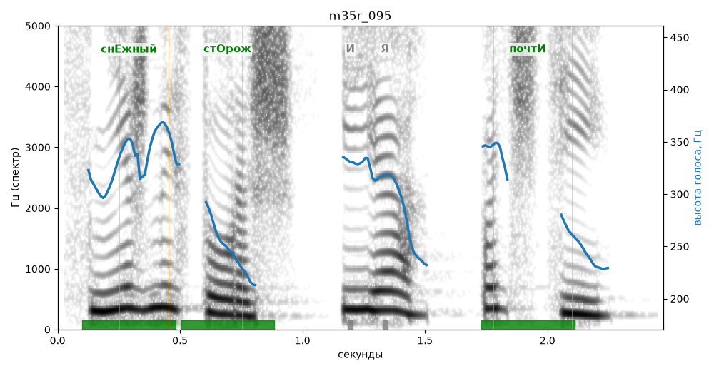

# m35r_095

Голос: **Рон (голос iPhone Milena), серия 35** · длительность 2.5 с
Эталон: Снежный сторож! И я! Почти.
Распознано: Снежный сторож, и я, почти!
Слова: все совпали

## Ударения
(где нужно: ruaccent)

| слово | нужно | у голоса | |
|---|---|---|---|
| снежный | снЕжный | снЕжный | ✓ |
| сторож | стОрож | стОрож | ✓ |
| почти | почтИ | почтИ | ✓ |

## Интонация
- ✗ «снежный сторож!» — восклицание звучит ровно, без эмоции
- Диапазон голоса 7.7 полутонов (живо), средняя высота 313 Гц

## Паузы и темп
- паузы на своих местах
- Темп 5.3 слога/с (нормально)

_Синяя линия — высота голоса. Над словами заглавная буква — где ударение должно быть; красным — голос поставил не туда (уверенно), оранжевым — возможно._
