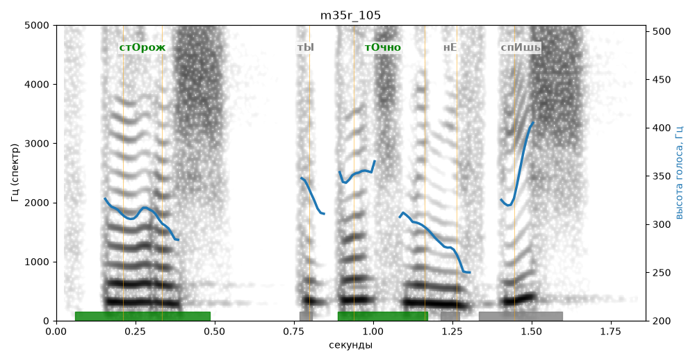

# m35r_105

Голос: **Рон (голос iPhone Milena), серия 35** · длительность 1.9 с
Эталон: Сторож, ты точно не спишь?
Распознано: Стораж, ты точно не спишь?
Расхождения в словах: «сторож» → «стораж»

## Ударения
(где нужно: ruaccent)

| слово | нужно | у голоса | |
|---|---|---|---|
| сторож | стОрож | стОрож | ✓ |
| точно | тОчно | тОчно | ✓ |

## Интонация
- ✓ «сторож ты точно не спишь?» — вопросительный подъём на слове «точно»
- Диапазон голоса 5.5 полутонов (нормально), средняя высота 313 Гц

## Паузы и темп
- паузы на своих местах
- Темп 5.6 слога/с (нормально)

_Синяя линия — высота голоса. Над словами заглавная буква — где ударение должно быть; красным — голос поставил не туда (уверенно), оранжевым — возможно._
