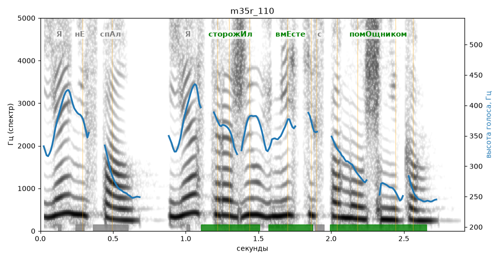

# m35r_110

Голос: **Рон (голос iPhone Milena), серия 35** · длительность 2.9 с
Эталон: Я не спал! Я сторожил вместе с помощником!
Распознано: Я не спал, я строжил вместе с помощником.
Расхождения в словах: «сторожил» → «строжил»

## Ударения
(где нужно: ruaccent)

| слово | нужно | у голоса | |
|---|---|---|---|
| сторожил | сторожИл | сторожИл | ✓ |
| вместе | вмЕсте | вмЕсте | ✓ |
| помощником | помОщником | помОщником | ✓ |

## Интонация
- ✗ «я сторожил вместе с помощником!» — восклицание звучит ровно, без эмоции
- Диапазон голоса 9.2 полутонов (живо), средняя высота 335 Гц

## Паузы и темп
- паузы на своих местах
- Темп 5.6 слога/с (нормально)

_Синяя линия — высота голоса. Над словами заглавная буква — где ударение должно быть; красным — голос поставил не туда (уверенно), оранжевым — возможно._
