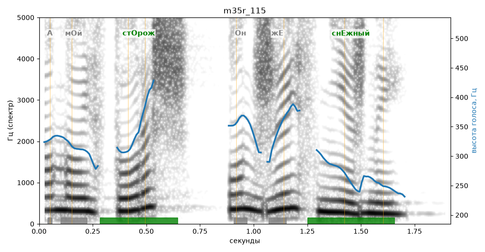

# m35r_115

Голос: **Рон (голос iPhone Milena), серия 35** · длительность 1.9 с
Эталон: А мой сторож? Он же снежный!
Распознано: А мой сторож он же снижный.
Расхождения в словах: «снежный» → «снижный»

## Ударения
(где нужно: ruaccent)

| слово | нужно | у голоса | |
|---|---|---|---|
| сторож | стОрож | стОрож | ✓ |
| снежный | снЕжный | снЕжный | ✓ |

## Интонация
- ✗ «а мой сторож?» — нет вопросительного подъёма (самое высокое место — «а», в начале) — звучит как утверждение
- ✓ «он же снежный!» — выделено слово «же» (+2.4 пт)
- Диапазон голоса 8.1 полутонов (живо), средняя высота 311 Гц

## Паузы и темп
- паузы на своих местах
- Темп 5.9 слога/с (нормально)

_Синяя линия — высота голоса. Над словами заглавная буква — где ударение должно быть; красным — голос поставил не туда (уверенно), оранжевым — возможно._
