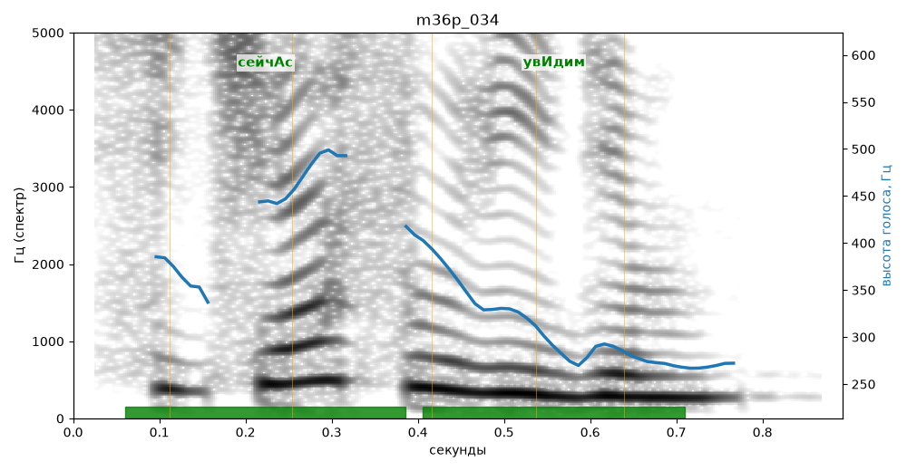

# m36p_034

Голос: **Пик (голос iPhone Milena), серия 36** · длительность 0.9 с
Эталон: Сейчас увидим.
Распознано: Сейчас увидим.
Слова: все совпали

## Ударения
(где нужно: ruaccent)

| слово | нужно | у голоса | |
|---|---|---|---|
| сейчас | сейчАс | сейчАс | ✓ |
| увидим | увИдим | увИдим | ✓ |

## Интонация
- ✓ «сейчас увидим.» — конец фразы понижается — звучит законченно
- Диапазон голоса 10.5 полутонов (живо), средняя высота 330 Гц

## Паузы и темп
- паузы на своих местах
- Темп 7.7 слога/с (быстро)

_Синяя линия — высота голоса. Над словами заглавная буква — где ударение должно быть; красным — голос поставил не туда (уверенно), оранжевым — возможно._
