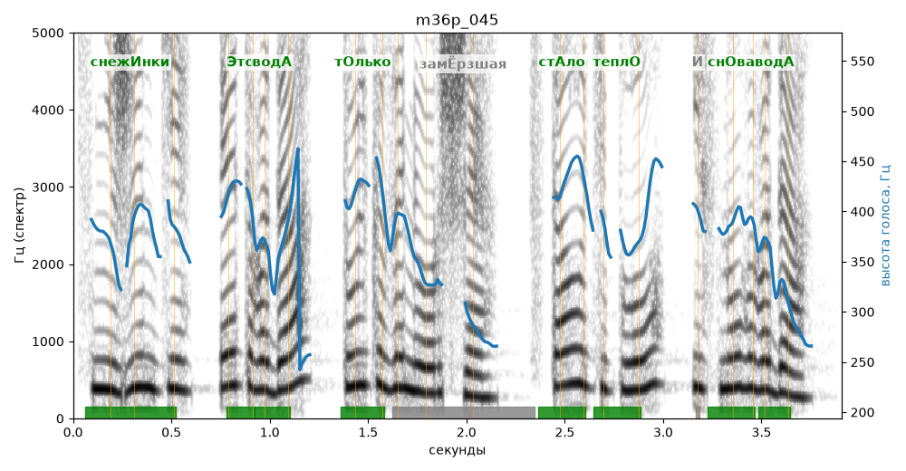

# m36p_045

Голос: **Пик (голос iPhone Milena), серия 36** · длительность 3.9 с
Эталон: Снежинки — это вода, только замёрзшая. Стало тепло — и снова вода.
Распознано: Снижинки, эта вода только заморжи. Стало тепло и снова вода.
Расхождения в словах: «снежинки это» → «снижинки эта»; «замерзшая» → «заморжи»

## Ударения
(где нужно: ruaccent)

| слово | нужно | у голоса | |
|---|---|---|---|
| снежинки | снежИнки | снежИнки | ✓ |
| это | Это | Это | ✓ |
| вода | водА | водА | ✓ |
| только | тОлько | тОлько | ✓ |
| замёрзшая | замЁрзшая | — | ? |
| стало | стАло | стАло | ✓ |
| тепло | теплО | теплО | ✓ |
| снова | снОва | снОва | ✓ |
| вода | водА | водА | ✓ |

## Интонация
- ✓ «снежинки это вода только замёрзшая.» — конец фразы понижается — звучит законченно
- ✓ «стало тепло и снова вода.» — конец фразы понижается — звучит законченно
- Диапазон голоса 8.8 полутонов (живо), средняя высота 380 Гц

## Паузы и темп
- после «замёрзшая.» пауза всего 0.02 с — фразы слипаются
- Темп 7.5 слога/с (быстро)

_Синяя линия — высота голоса. Над словами заглавная буква — где ударение должно быть; красным — голос поставил не туда (уверенно), оранжевым — возможно._
